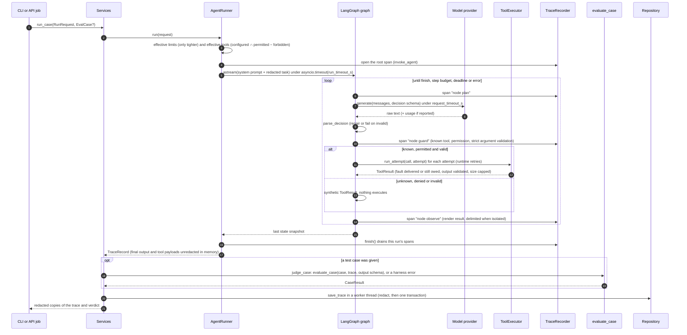
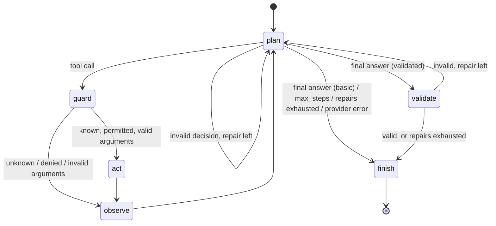
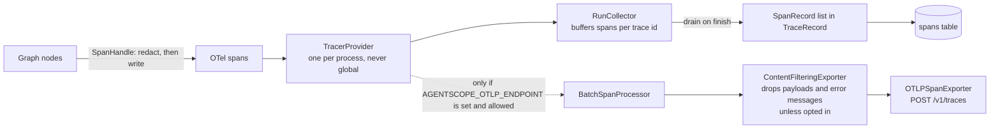
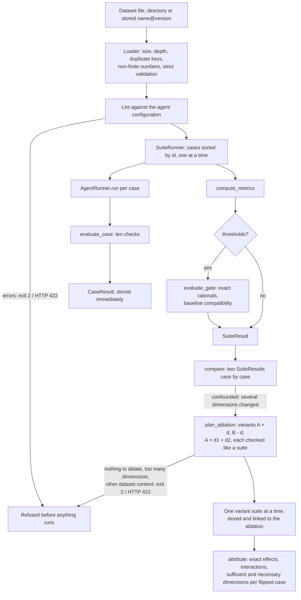
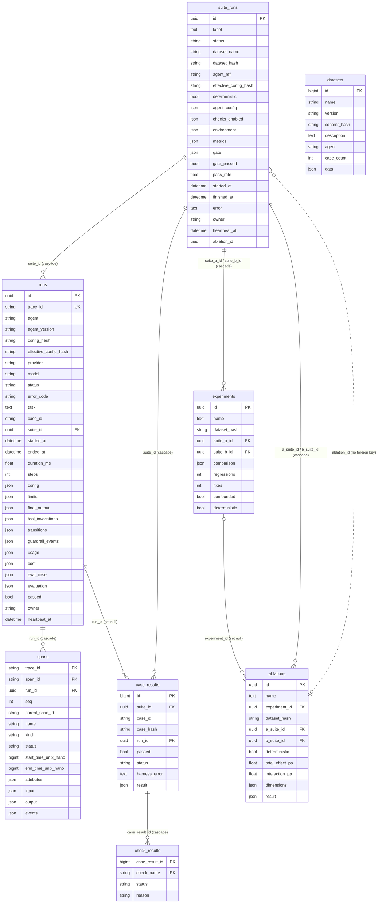

# Architecture

This document describes AgentScope 1.0.0 (V1) as implemented in `src/agentscope` and
`frontend/`. File paths are relative to the repository root.

## Components and responsibilities

| Component | Location | Responsibility |
|---|---|---|
| Bootstrap | `src/agentscope/_bootstrap.py` | Imported first by the package. Forces LangSmith/LangChain tracing off, removes LangSmith keys and `OTEL_EXPORTER_OTLP_*`, `OTEL_SPAN_*`, `OTEL_ATTRIBUTE_*`, `OTEL_TRACES_EXPORTER`, `OTEL_SDK_DISABLED` from the process environment, and sets the `httpx`/`httpcore` loggers to WARNING. |
| Settings | `src/agentscope/config.py` | `AGENTSCOPE_*` environment variables (pydantic-settings, no `.env` file is ever read). The only source of network destinations. |
| Domain contracts | `src/agentscope/domain/` | Pydantic models shared by every layer: agent configuration, tools and faults, traces, datasets, evaluation results, comparisons, ablations. All reject unknown fields and non-finite floats. |
| Runtime | `src/agentscope/runtime/` | The LangGraph state machine (`graph.py`), the run loop with timeouts and the `TraceRecord` it returns (`runner.py`), the decision protocol (`protocol.py`), prompt building and untrusted-content rendering (`prompts.py`), the permission guard and heuristic content scanner (`guards.py`), model-fault injection (`model_faults.py`). |
| Agents | `src/agentscope/agents/` | `AgentDefinition`s: toolset, output model, prompt texts, built-in versions, and the deterministic brain the fake model uses. Two agents: `research_assistant`, `task_planner`. |
| Providers | `src/agentscope/providers/` | The fake provider, Ollama, and an opt-in OpenAI-compatible provider; the egress policy (also the source of the OTLP endpoint) and the only factory for provider HTTP clients (`http.py`); provider status probes. |
| Tools | `src/agentscope/tools/` | Simulated tools over packaged JSON data, the registry (versioned schemas), the executor (validation, fault injection, timeout, output checks), and the per-run fault plan (calls counted per tool). |
| Tracing | `src/agentscope/tracing/` | One process-wide tracer provider and per-run span collection (`recorder.py`), redaction (`redaction.py`), attribute names (`semconv.py`), optional OTLP export (`export.py`). |
| Evaluation | `src/agentscope/evaluation/` | The ten checks, per-case evaluation, metrics, gates, baselines and the environment fingerprint. Imports only `agentscope.domain`, `agentscope.evaluation`, `jsonschema`, `pydantic` and the standard library. |
| Experiments | `src/agentscope/experiments/` | Case-by-case comparison of two suite results (`compare.py`), and ablation attribution (`ablation.py`): plans the variant configurations that change one or two dimensions at a time and attributes a change from their suite results. Both are pure: they run and store nothing. |
| Datasets | `src/agentscope/datasets/` | The hardened loader, the linter, canonical export, and the two built-in datasets. |
| Suite runner | `src/agentscope/suite_runner.py` | Runs a dataset's cases sequentially against one configuration and aggregates verdicts; classifies harness errors (`judge_case`). Never touches storage or the API (callers persist through its `on_case` hook). |
| Services | `src/agentscope/services.py` | Wires runtime, evaluation and storage together; the single engine used by both the CLI and the API. Hands back redacted copies of everything it returns; heartbeats running suites, plans and runs ablations, recovers interrupted work, and purges while keeping the built-in datasets. |
| Storage | `src/agentscope/storage/` | SQLAlchemy 2 ORM models, portable column types, engine setup and SQLite hardening, Alembic migrations, liveness of in-flight work (`liveness.py`), and the repository: the only writer, which redacts every model before saving. |
| Jobs | `src/agentscope/jobs.py` | In-process background jobs for long API operations. |
| API | `src/agentscope/api/` | FastAPI application, security middleware (`security.py`), routes, request and response schemas (`schemas.py`, the contract the dashboard is built on). |
| CLI | `src/agentscope/cli/` | Typer commands with documented exit codes and terminal-safe output. |
| Dashboard | `frontend/` | Vue 3 + TypeScript single-page app served by `agentscope serve` from `frontend/dist` (or `agentscope/web/dist` inside a wheel). |

## A run's data flow

The sequence below is `Services.run_case` for one task, as triggered by `agentscope run` or
`POST /api/runs`. Suites call the same runner once per case.

The model receives the task redacted, so a secret pasted into a task never reaches a
provider. Checks judge the unredacted in-memory trace (final output and tool payloads), so a
secret-shaped string the model leaked still counts as a leak; everything stored or returned
is redacted (`tests/integration/test_unredacted_evaluation.py`). A run whose model provider
failed (`provider_error`, `provider_timeout`) is a harness error, not a verdict on the agent.
Runs are persisted once, after they finish; there is no in-progress run row. Suites are
created as `running` (with their owner and a heartbeat) before their first case, and every
case is stored as soon as it is judged.

## The state machine

`build_graph` in `src/agentscope/runtime/graph.py` builds a `StateGraph` per run (the nodes
are closures over the run's context). `topology()` returns the edge list, which is part of
the effective configuration hash:

| From | To | When | Variant |
|---|---|---|---|
| `START` | `plan` | run starts | both |
| `plan` | `guard` | the model requested a tool | both |
| `plan` | `finish` | final answer (basic graph); step budget exhausted (`max_steps`); decision repairs exhausted (`failed`); provider failure or provider timeout (`error`) | both |
| `plan` | `plan` | invalid decision and a decision repair remains | both |
| `plan` | `validate` | final answer | validated |
| `guard` | `act` | known tool, permitted, valid arguments | both |
| `guard` | `observe` | unknown tool, denied or invalid arguments; nothing executes | both |
| `act` | `observe` | always (runtime retries happen inside `act`, one span per attempt) | both |
| `observe` | `plan` | always | both |
| `validate` | `finish` | output matches the schema (`completed`), or repairs exhausted (`failed`) | validated |
| `validate` | `plan` | output invalid and an output repair remains | validated |
| `finish` | `END` | always | both |

The step budget is checked at the top of `plan`, before any model call. LangGraph's
`recursion_limit` is passed explicitly as `4·max_steps + max_decision_repairs +
2·max_output_repairs + 8` and is only a backstop; if it fires the run ends with status `error`
and code `internal_recursion_limit`, which the suite runner treats as a harness error. A run
that passes `run_timeout_s` ends with status `timeout` and keeps the partial state streamed so
far, including a tool call the deadline interrupted; its closing transition starts from the
node that was running. Run statuses and error codes are listed in
[docs/AGENT_RUNTIME.md](docs/AGENT_RUNTIME.md).

## Tracing pipeline

- `TracingPipeline` passes every SDK option explicitly (always-on sampler, resource with
  `service.name` and `service.version`, span limits of 256 attributes and 256 events per span
  with no attribute length limit), because the SDK falls back to `OTEL_*` variables for
  anything left unset. It is never installed as the OpenTelemetry global provider.
- The first span a `TraceRecorder` opens is the run's root and registers its trace id with the
  collector; spans from unregistered traces are counted and dropped. Each run drains only its
  own buffer, so concurrent runs cannot mix spans.
- Span names, payloads, string attributes, event attributes and status messages are redacted
  when written to the span, so neither storage nor the exporter ever sees raw secrets. Failed
  spans also carry `error.type`, which is what the exporter sends instead of the status
  message when payload export is off.

Details: [docs/TRACING.md](docs/TRACING.md).

## Evaluation pipeline

- Input problems (wrong agent, unknown configuration, disabled provider, lint errors, no
  enabled checks, incompatible baseline) are raised before any case runs.
- A harness failure in one case (an exception, or a run that ended with `internal_error`,
  `internal_recursion_limit`, `provider_error` or `provider_timeout`) becomes that case's
  `harness_error`; it is never counted as a pass, is not judged by any check, fails the gate
  through `max_harness_errors`, and makes the CLI exit 3.
- `SuiteResult` records `checks_enabled`, the dataset hash, `config_hash`,
  `effective_config_hash`, and an environment fingerprint with the check engine version and
  per-component hashes of the resolved prompt, tool schemas, output schema, graph and fake
  brain, which comparisons use to name what changed.
- An ablation (`Services.plan_ablation`, then `execute_ablation`) explains a comparison: A
  and B are reused when it starts from a stored experiment (whose stored dataset version must
  still have the content hash they evaluated) and evaluated first otherwise; every variant is
  checked like a suite before anything runs (an invalid one is skipped with a warning), and
  the variants then run one at a time, with progress counted over the cases of every suite
  still to run. `experiments.ablation.attribute` builds the `Ablation` from the suite results,
  which the repository stores at the end.

Details: [docs/EVALUATION.md](docs/EVALUATION.md).

## Storage schema

Tables are defined in `src/agentscope/storage/models.py` and created by four Alembic
revisions: `0001` runs and spans; `0002` datasets, suites, case and check results,
experiments; `0003` the nullable `owner` and `heartbeat_at` columns on `runs` and
`suite_runs` (added in place, no table rebuild; rows written before it have no owner);
`0004` the `ablations` table and the nullable, indexed `suite_runs.ablation_id` (also added
in place). Alembic also keeps its own `alembic_version` table.

The diagram lists the main columns; `models.py` has all of them. Portability rules
(`src/agentscope/storage/types.py`): JSON columns are `JSON` on SQLite and `JSONB` on
PostgreSQL, with Python `None` stored as SQL `NULL`; datetimes are timezone-aware UTC on both
backends (naive values are rejected on write); surrogate keys are `BIGINT` on PostgreSQL and
`INTEGER` (rowid alias) on SQLite; statuses are plain strings validated in Pydantic. Unique
constraints: `runs.trace_id`, `datasets(name, version)` (a version is immutable; re-importing
other content under it is a conflict) and `case_results(suite_id, case_id)`. A metadata naming
convention gives every constraint and index a deterministic name.

SQLite connections set `foreign_keys=ON`, `busy_timeout=5000`, `journal_mode=WAL` and
`secure_delete=ON`. Only a database directory that AgentScope creates itself is made private
(`0700`, with a `.gitignore` containing `*`); an existing directory is left as it is, and a
new database file is created `0600`. Migrations run in one transaction (`BEGIN IMMEDIATE` on
SQLite, a transaction-scoped advisory lock on PostgreSQL), with foreign keys re-checked before
commit on SQLite; a database revision unknown to the running code raises `DatabaseAheadError`
("database revision X is unknown to this AgentScope version; upgrade AgentScope", CLI exit 3).
`build_services` upgrades to head and registers the built-in datasets; it never changes
running work, because read-only commands start the same way.

List pages and their totals come from one statement (a `count(*) OVER ()` window), so a row
committed between two queries can never make a page longer than its total.

An ablation's variant suites are ordinary suites (their runs and traces open like any other)
with `ablation_id` set. The suite list leaves them out unless asked (`include_ablations`);
the overview (its suite count, recent suites, pass-rate series and latest gate; their runs
still count among the runs) and the failure analysis's default selection always do.
`ablation_id` is not a foreign
key: a variant suite is created, `running`, before its ablation is stored, which happens only
once every variant finished. The repository therefore cascades itself: a purge that deletes
ablations (scope `experiments`, or a deleted A or B suite cascading through
`a_suite_id`/`b_suite_id`) then deletes their variant suites, repeating while that cascades
to further ablations. An ablation that does not finish (an exception, a cancelled job, an
interrupted command) deletes the variant suites it stored
(`Repository.discard_ablation_variants`, which does nothing once the ablation is stored);
only a process that dies outright leaves them, still hidden, until purging evaluations
deletes them.

### Liveness and recovery

Several processes can share one database: a server, CLI evaluations, another host on
PostgreSQL. A suite (or a run, should one ever be stored unfinished) that is stored `running`
records its owner, `host:pid:incarnation` (`src/agentscope/storage/liveness.py`), and a
heartbeat. `create_suite` writes both, every recorded case refreshes the heartbeat, and
`Services.run_suite` refreshes it every 30 seconds while a case runs. The incarnation is a
random value per process, renewed in forked children, so a server restarted in the same
container (same hostname, pid 1 again) does not mistake its predecessor's rows for its own.

`Repository.mark_interrupted` marks a `running` row `error` with "interrupted: the process
stopped before this finished" (runs also get `error_code=interrupted`) only when:

- its owner is a process on this host that no longer exists, or an earlier process that had
  this process's pid; or
- its owner cannot be checked from here (another host, no owner recorded, or Windows) and its
  heartbeat (its start time, for rows without one) is older than 5 minutes.

A live pid on this host is never marked, even with a silent heartbeat: the process may be
suspended and resume. A pid that an unrelated process reused (for example after a reboot)
also reads as alive, so such a row stays `running` rather than risk marking live work. A
marked row gets its finish time, so a late writer is refused (`record_case` and
`finish_suite` reject a finished suite) instead of reviving it.

Recovery runs from `Services.recover_interrupted`, called by the API at startup and every
minute, and by the CLI commands that start work (`run`, `eval`, `compare`, `ablate`,
`demo seed`);
`agentscope db upgrade` runs it too. Other commands (`traces`, `datasets`, `agents`,
`db info`, `db purge`) never do.

## API and in-memory jobs

Routes (`src/agentscope/api/routes/`):

| Method and path | Purpose |
|---|---|
| `GET /api/health` | Status and version. |
| `GET /api/agents`, `GET /api/providers` | Agent definitions (with `version_hashes`: the `config_hash` and `effective_config_hash` of each built-in version) and tool specs; provider status (probes enabled providers). |
| `GET /api/runs`, `GET /api/runs/{id}`, `GET /api/runs/{id}/export` | Run list with filters and `limit` (1 to 200, default 50) / `offset`, answered as `{items, total}`; run detail (trace, case, verdict); JSON attachment. |
| `POST /api/runs` | Start a run (202 + job). Built-in `agent_ref` or a full `config`; optional `expected` makes it an ad-hoc case. The task must be 1 to 4000 characters without NUL or unpaired surrogates. |
| `GET /api/datasets`, `GET /api/datasets/{name}/{version}`, `.../export` | Stored datasets; detail, whose `dataset` is the canonical export document, so it can be posted back unchanged (for example to fork a version); canonical export. |
| `POST /api/datasets`, `POST /api/datasets/validate` | Import (201, 409 conflict, 422 invalid) and lint without importing; the raw JSON document is the body. |
| `GET /api/evaluations`, `GET /api/evaluations/{id}`, `.../export` | Suite list (filters `agent_ref`, `dataset`, `status`; ablation variant suites only with `include_ablations=true`; `limit` 1 to 200, default 50, and `offset`; a bare array with the total matching count in the `X-Total-Count` header) and detail. |
| `POST /api/evaluations` | Start a suite (202 + job). |
| `GET /api/experiments`, `GET /api/experiments/{id}` | Comparisons (`limit`/`offset` and `X-Total-Count` as above). |
| `POST /api/experiments` | `suite_a` + `suite_b`: compare two completed suites now (201), or return the stored comparison of the same ordered pair (200); 404 for an unknown suite, 409 for one that is not completed. `dataset` + `a` + `b`: run both sides (202 + job). |
| `GET /api/ablations`, `GET /api/ablations/{id}` | Ablations, newest first (filter `experiment_id`; `limit`/`offset` and `X-Total-Count` as above), and the full `Ablation`. |
| `POST /api/ablations` | `experiment_id`: explain that stored comparison with its own A and B suites; `dataset` + `a` + `b`: evaluate both sides first (202 + job of kind `ablation`, whose `resource_id` is the ablation id). Everything that can be refused is answered before a job starts: 404 for an unknown experiment or dataset, 422 for an unusable agent, nothing to ablate, more than 8 dimensions or suites of different dataset content. |
| `GET /api/overview`, `GET /api/failures` | Read-only aggregations over stored verdicts (the overview also probes providers). |
| `GET /api/jobs/{id}` | Job state and progress. |
| `GET /api/settings`, `POST /api/settings/purge` | Redacted effective settings, storage inventory, egress list and privacy statements; purge (body `{"confirm": "PURGE", "scope": ..., "before": ...}`; the built-in datasets are kept). A 409 carries a `code`: `jobs_running` (refused, nothing deleted) or `purge_incomplete` (rows deleted, `result` attached, old contents still on disk). |
| `POST /api/demo/seed` | Seed the demo story (202 + job; returns the running job if one exists). |
| `GET /api/openapi.json` | The OpenAPI document. There is no interactive docs page: Swagger UI loads assets from a CDN, which the CSP blocks, so it is disabled. |

`LocalOnlyMiddleware` wraps every request: Host check, optional bearer token, mutation guard,
body limit and security headers ([SECURITY.md](SECURITY.md)). Errors never carry tracebacks:
an unhandled exception is answered `{"detail": "internal error"}` with status 500 and logged
as type, method and path only. Request validation errors are answered 422 with located issues
and without echoing the submitted values.

`JobManager` (`src/agentscope/jobs.py`) runs at most 2 jobs at once with up to 16 more queued;
beyond that `POST` answers 429. It keeps the 200 most recent finished jobs. Jobs exist only in
the server's memory: after a restart their ids answer 404, while whatever they stored stays,
and suites a dead process left `running` are marked `error` ("interrupted") by recovery.
Evaluation, experiment and ablation jobs end `failed` (`UnjudgedCasesError: N of M cases could
not be judged ...`) when any case is a harness error; the suite, comparison or ablation is
stored all the same.
Shutdown cancels and awaits unfinished jobs. Clients poll `GET /api/jobs/{id}` and then fetch
the resource named in `resource_id`.

## Frontend structure

| Path | Contents |
|---|---|
| `frontend/src/api/` | `client.ts` (typed fetch wrapper; sets `X-AgentScope-Client: 1` and `Content-Type: application/json` on non-GET requests; job polling; paged lists read `X-Total-Count`; dataset validation and import send the user's text byte for byte, so the server's strict loader sees exactly the file; the located `issues` of a 422 are kept), `types.ts` (hand-written TypeScript mirror of `api/schemas.py` and the domain models), `errors.ts`. |
| `frontend/src/router.ts` | Routes: `/overview`, `/runs`, `/runs/:runId`, `/evaluations`, `/evaluations/:suiteId`, `/evaluations/:suiteId/cases/:caseId`, `/compare`, `/compare/runs`, `/failures`, `/agents`, `/agents/:agent/:version`, `/datasets`, `/datasets/:name/:version`, `/settings`. |
| `frontend/src/views/` | One component per screen. |
| `frontend/src/components/` | `trace/` (span tree, transition strip, duration bars, verdict panel, span detail tabs), `compare/` (config diff, metric deltas, flip list, trace diff and the pure `alignSteps.ts`), `evaluation/`, `failures/`, `overview/`, `runs/`, `datasets/`, `settings/`, `agents/`, `charts/`, `shell/`, `ui/` (JSON viewer built from text nodes, redacted-value and truncation notices, status badges). |
| `frontend/src/composables/` | `useTraceModel.ts` (pure step model of a trace), `useQueryState.ts` (view state in the URL), `keybindings.ts` (the single shortcut registry), resource loading, job polling, paging (`paging.ts`), the New run drawer state, theme. |
| `frontend/src/styles/` | `tokens.css` (semantic color tokens for both themes, checked for WCAG AA contrast by `styles/__tests__/contrast.spec.ts`) and `base.css`. |
| `frontend/public/theme-init.js` | Applies the saved theme before first paint; an external file because the CSP forbids inline scripts. |
| `frontend/e2e/`, `frontend/playwright.config.ts` | Playwright end-to-end tests against the real stack: the built dashboard served by `agentscope serve` on `127.0.0.1:8799` over a freshly seeded throwaway database; the `screenshots` project regenerates `docs/images/`. |

Trace and dataset strings are treated as hostile: ESLint enforces `vue/no-v-html: error`, and
`src/__tests__/no-raw-html.spec.ts` fails on `v-html`, `innerHTML`/`outerHTML`,
`insertAdjacentHTML` and `document.write(` in application sources.

## Deployment

`Dockerfile` builds one image (dashboard built with Node, AgentScope installed from
`uv.lock` with the `postgres` extra, run as the unprivileged user `agentscope`, data in the
`/data` volume) whose command is `agentscope serve --container`. `docker-compose.yml` adds
PostgreSQL on an internal network and publishes only `127.0.0.1:8765`;
`docker-compose.ollama.yml` adds a local Ollama server. Container mode and its exposure rules
are described in [SECURITY.md](SECURITY.md#container-mode) and
[docs/LOCAL_DEVELOPMENT.md](docs/LOCAL_DEVELOPMENT.md#docker).

## Key decisions and trade-offs

| Decision | Rejected alternative | Why |
|---|---|---|
| One `TracerProvider` per process, never registered as the OTel global; a span processor routes spans to runs by trace id. | A provider per run. | Per-run providers mean one export thread per run once OTLP is on, and shutting one down affects shared processors. Not touching the global keeps AgentScope from interfering with, or being redirected by, other instrumentation. |
| Redact when writing to a span, and again in the repository on every save. | Redact in a collector before export. | Every span processor receives the same immutable span, so a collector cannot clean what an exporter sees; and records, verdicts and CLI output never pass through a collector. |
| A flat decision object `{type, tool, arguments, output, rationale}` sent as JSON text, with `tool` a free string. | A discriminated union at the schema root; native tool calling; an enum of permitted tools. | Constrained decoders (Ollama's `format`, OpenAI-compatible `json_schema`) handle flat objects reliably; JSON text works the same on every provider; a free-string tool keeps unauthorized requests observable so the guard, not the decoder, rejects them. |
| The fake model's decisions go through the same text parsing as real replies. | Brains returning decision objects directly. | Otherwise `schema_validity`, invalid-decision handling and the repair loops would never be exercised. |
| Tool arguments validated with the tool's Pydantic model in strict JSON mode. | JSON Schema validation; Pydantic lax mode. | One source of truth for the schema the model sees and the validation applied; lax mode would turn `"5"` into `5` and hide the violations `tool_arguments` is meant to catch. Final outputs are validated with `jsonschema` against the agent's output schema, by the runtime's `validate` node (validated graph) and independently by the evaluator. |
| Untrusted tool output HTML-escaped inside one `<tool_output>` block. | A nonce-tagged closing delimiter; pattern-based escaping. | Escaping cannot be forged and gives identical bytes on every rerun; `html.unescape` recovers the exact text (property-tested). |
| The evaluator imports nothing from the runtime and checks the output schema itself. | Grading with the guard's decisions, the scanner's findings or the validate node's verdict. | A regression in those components would otherwise make its own verdicts pass. The basic graph has no validate node at all. |
| Three check states, with missing data always a failure. | A single `skipped` state. | `skipped` conflated "no expectation" with "could not evaluate", so a crashed run could pass. |
| Gates compare rationals parsed from the written decimal. | Float comparison. | In floats, a drop from 4/10 to 3/10 is 10.000000000000004 pp and fails a 10 pp limit. |
| Canonical JSON baselines without ids, timestamps or durations, written only by `--write-baseline`. | Comparing against the last stored run. | Baseline changes show up as reviewable diffs, and regenerating from unchanged inputs gives identical bytes. |
| Ablations change each dimension alone in both directions (A + d, B − d) and in forward pairs (up to 6 dimensions); what single dimensions do not explain is reported as the interaction. | A full factorial design (2^k suites); Shapley values. | 2k + k(k−1)/2 variant suites stay affordable (20 for the five dimensions of research v1 → v2, where a full factorial needs 30 besides A and B), both directions answer "is it enough alone?" and "is it still needed?", and pair interactions locate dimensions that only work together without spreading the remainder over dimensions by a formula. |
| Cases run sequentially; jobs limited to 2 running and 16 queued. | Concurrent case execution. | Deterministic order and output; fake runs are fast and a local model gains little from concurrency. |
| In-memory jobs. | A persistent job queue. | A single local process needs no broker; what a job stores is persisted as it goes, and suites whose process died are marked by recovery. |
| An owner (`host:pid:incarnation`) and a heartbeat on running suites; recovery marks only rows whose owner is gone or, when that cannot be checked, silent for 5 minutes. | Marking every `running` row at startup. | The CLI and the server share one database: blind marking turned another process's live suite into an error whenever any command started. |
| The guard checks that a tool exists before checking permission. | Permission first. | A hallucinated or corrupted name is not an attempt at a real capability; counting it as unauthorized inflated the security metric. The cost is that a model can tell which unpermitted names exist. |
| Output faults stay owed until delivered; failure faults apply by call position. | Consuming every fault on its scheduled call. | An injection scheduled on a call that failed, or had nothing to carry it, would vanish unrecorded, and the injection checks would pass without being exercised. |
| `json.dumps(sort_keys=True, separators=(",", ":"), ensure_ascii=False, allow_nan=False)` as the canonical encoding. | Full RFC 8785 (JCS). | Inputs are validated and finite, so a documented `json.dumps` profile is deterministic without a new dependency. |
| No LLM judge in V1; contracts have no judge field. | A model-based score next to the deterministic checks. | A judge field inside shared models is how judge scores end up in metrics and gates; doing it properly also needs injection-safe prompting and recorded model digests. |
| SQLite by default, PostgreSQL optional, one schema for both. | PostgreSQL only. | A local tool should work with no server; portable column types keep one migration history. |
| Remote mode requires a bearer token on every request, static files included. | Cookie or session login for the dashboard. | Out of scope for a single-user tool; the consequence (the dashboard cannot be used in remote mode) is documented in [SECURITY.md](SECURITY.md). |
| A `StateGraph` compiled per run with closures over the run context. | One graph compiled per variant, with dependencies passed through LangGraph's context. | Simpler code; compiling is cheap next to a run. Append-only records (tool invocations, guardrail events) live on the run context so they survive a run-level timeout. |
